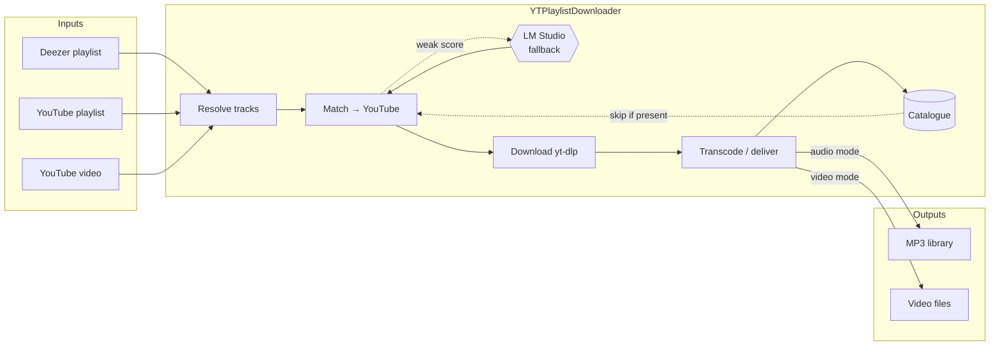
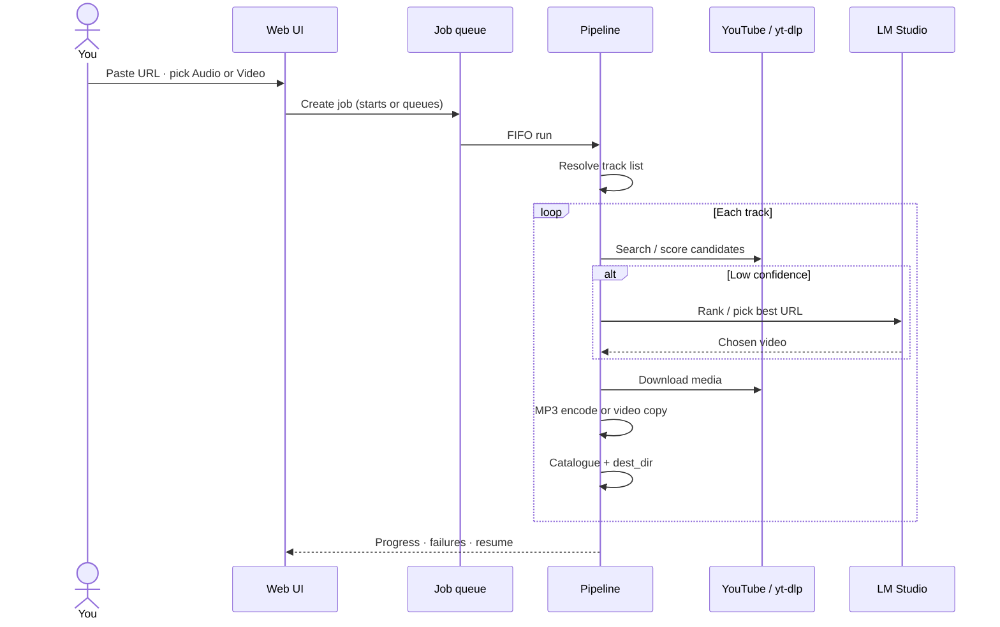

# YTPlaylistDownloader

Local desktop web app that turns a **Deezer playlist**, **YouTube playlist**, or **single YouTube video** into files on disk — either tagged **MP3** audio or a **full-quality video** copy — with a queueable job pipeline, live progress, and an optional local LLM to improve YouTube matching when heuristics are unsure.

It binds to `127.0.0.1` by default. Nothing is uploaded to a cloud service you do not configure yourself.

## What it does

| | |
| --- | --- |
| **Inputs** | Deezer playlist URL · YouTube playlist URL · YouTube video / short URL |
| **Outputs (audio)** | MP3 at ~192 kbps under `dest_dir`, plus a SQLite catalogue of finished tracks |
| **Outputs (video)** | Best-quality muxed file (typically MP4) copied as-is into `dest_dir` — no audio strip, no chapter slicing |
| **Skips** | Already-delivered outputs (catalogue / file present), unless **Force reprocess** is checked |
| **LLM (optional)** | LM Studio OpenAI-compatible API — used only as a **match fallback** when static scoring cannot pick a confident YouTube candidate |

### High-level flow



### Pipeline stages



### Why the LLM is there

Matching playlist metadata to the right YouTube upload is noisy (covers, live versions, wrong duration). The app first uses **deterministic scoring**. When that score is weak, it can ask a **local** model via LM Studio to choose among candidates. If LM Studio is offline, matching still runs — only the fallback is skipped.

### UI capabilities (high level)

- **Job** — create from URL, audio vs video, force reprocess, FIFO queue, resume / retry failures / cancel, delete one job or purge all completed (files on disk are kept)
- **Progress** — live stage and per-track bars; manual YouTube URL override on failures
- **Catalogue** — finished output paths recorded after delivery
- **Config** — bind address, work/dest dirs, LM Studio endpoint; **language** (English default, Français) persisted in `config/app.yaml`

## Quick start

1. Install **Python 3.14** and put **ffmpeg** on `PATH`.
2. From the repo root:

```powershell
.\Start-App.ps1
```

`Start-App.ps1` creates a repo-local **`.venv`** with Python 3.14 if it does not exist yet, then runs `pip install -e .` into that venv (installs / refreshes the app package and its dependencies). You do not need to install requirements by hand; the script always targets `.venv`, not whatever global/`conda` env happens to be active in your shell.

3. Open the URL printed in the console (default `http://127.0.0.1:8765`).
4. Optional: start [LM Studio](https://lmstudio.ai/) with an OpenAI-compatible server on `http://127.0.0.1:1234/v1` and set `lm_model` in Config / `config/app.yaml`.
5. Job tab → paste a playlist or video URL → choose **Audio (MP3)** or **Video** → **Create job**.

## Requirements

- Python **3.14** (free-threaded build preferred)
- `ffmpeg` on `PATH` for audio transcoding and video remux/copy
- Optional: [LM Studio](https://lmstudio.ai/) on `http://127.0.0.1:1234/v1` for LLM match fallback when static scoring is weak
- Optional: YouTube cookies when yt-dlp is blocked (age gate, bot check, “Sign in to confirm you’re not a bot”) — see below

## YouTube cookies

yt-dlp talks to YouTube **as a guest** unless you give it a logged-in session. Cookies fix most “login required” / bot-check download failures. Configure them in `config/app.yaml` (then **restart the app** — cookie settings are read at startup).

| Key | Meaning |
| --- | --- |
| `youtube_cookies_file` | Path to a Netscape `cookies.txt` export (relative to the repo root, e.g. `config/youtube_cookies.txt`) |
| `youtube_cookies_from_browser` | Browser name for yt-dlp `--cookies-from-browser` (`chrome`, `brave`, `edge`, `firefox`, …) |

**Priority:** if `youtube_cookies_file` is non-empty, it is used and the browser setting is ignored. Leave the file empty (`""`) to use the browser instead. Leave both empty to run without cookies.

### Option A — cookies file (recommended on Windows)

Reading Chrome/Brave cookies live often fails with **DPAPI / “failed to decrypt”** while the browser is open. An exported file avoids that.

1. In your browser, log into [YouTube](https://www.youtube.com) (the account that can watch the videos you care about).
2. Install a **local** cookie exporter, e.g. **“Get cookies.txt LOCALLY”** (Chrome / Edge / Brave / Firefox extension — export stays on your machine).
3. Open YouTube, use the extension → **Export** for `youtube.com` (Netscape format).
4. Save the file as `config/youtube_cookies.txt` (already gitignored — never commit it).
5. In `config/app.yaml`:

```yaml
youtube_cookies_from_browser: ""
youtube_cookies_file: config/youtube_cookies.txt
```

6. Restart the app (`.\Start-App.ps1`). Re-export when downloads start failing again (cookies expire or YouTube invalidates the session).

### Option B — cookies from browser

yt-dlp opens your browser’s cookie store directly. Useful on Linux/macOS, or when a file export is inconvenient.

1. Log into YouTube in that browser.
2. **Fully quit** the browser (all windows; check the tray on Windows) so the cookie DB is not locked / undecryptable.
3. In `config/app.yaml`, point at that browser and clear the file path:

```yaml
youtube_cookies_from_browser: brave
youtube_cookies_file: ""
```

Use `chrome`, `edge`, or `firefox` instead of `brave` if that is where you are logged in.

4. Restart the app. If you see DPAPI / decrypt errors, switch to **Option A**.

### Security notes

- Cookies are equivalent to being logged into your Google/YouTube account — treat `config/youtube_cookies.txt` like a password.
- The path is gitignored; do not paste cookie contents into issues or PRs.

## Daily usage

1. **Config** — relative `work_dir` / `dest_dir`, LM Studio URL/model, language (header dropdown or `ui_locale` in YAML).
2. **Job** — paste a Deezer playlist, YouTube playlist, or single video URL; pick **Audio** or **Video**; optionally **Force reprocess**.
3. **Create job** — starts immediately, or queues FIFO if another pipeline is running. After restart, interrupted / queued jobs resume automatically.
4. Select a saved job in the list to inspect tracks. **Resume** continues cancelled / failed / incomplete work; **Retry failures** resets match/download errors then restarts; **Cancel** stops between stages.
5. **Delete** removes one finished/idle job record; **Delete completed** clears every completed job from the list (outputs in `dest_dir` stay).
6. **Progress** — live stage / track bars; override a failed match with a YouTube URL when needed.
7. **Catalogue** — lists finished delivery paths.

Working files live under `work_dir/<job-id>/`; durable outputs under `dest_dir`.

## Tests

```powershell
.\Run-Tests.ps1
```
